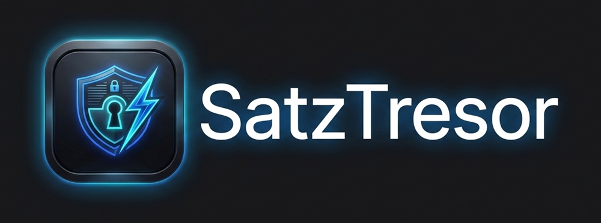

<div align="center">



### Dein lokaler, verschlüsselter Satzbaustein-Manager für Windows
**Blitzschnelle Textvorlagen & automatische Kürzel-Ersetzung — 100 % Offline. 0 % Cloud. 0 € Abo.**

[](./package.json)
[-0078d4?style=for-the-badge&logo=windows)](./package.json)
[](./PRIVACY.md)
[](./src/crypto.js)
[](./LICENSE)

</div>

---

## Warum SatzTresor?

Viele moderne Text-Expander und Satzbaustein-Programme zwingen Nutzer heute in **Cloud-Konten, Registrierungen oder Monatsabos** — ein No-Go für alle, die im Büro, in der Kanzlei, in der Praxis oder privat sensible Texte schreiben und ihre Daten nicht auf fremden Servern hinterlassen wollen.

**SatzTresor** löst genau dieses Problem:
* **100 % Lokal & Privat:** Alle Satzbausteine liegen ausschließlich auf deinem PC. Es gibt keinen Account, keine Cloud und keine Telemetrie.
* **Optionaler AES-256-Tresor:** Auf Wunsch verschlüsselst du deine gesamte Datenbank mit einem Master-Passwort (`AES-256-CBC` + `PBKDF2-SHA256` mit 100.000 Runden + `HMAC-SHA256`).
* **Sofort einsatzbereit ohne Konfigurations-Dateien:** Moderne Oberfläche (dunkel & hell) statt komplizierter Skript- oder YAML-Dateien.

---

## 📥 Download & Installation (Kostenlos)

Wähle den passenden Weg für deinen PC:

| 🟢 Weg 1: Microsoft Store *(Empfohlen für normale PCs)* | 🔵 Weg 2: Direkt-Download *(Für Büro-PCs & Puristen)* |
| :--- | :--- |
| **1-Klick-Installation ohne Windows-Warnmeldung**<br>*(Durch Microsoft signiert + automatische Updates)* | **Keine Store-Anmeldung & keine Admin-Rechte nötig**<br>*(Ideal, wenn auf dem Büro-PC der Store gesperrt ist)* |
| 👉 **[Im Microsoft Store öffnen](#)** *(In Kürze verfügbar)* | 👉 **[SatzTresor-Portable-1.5.4.exe](../../releases/latest)** *(Direktstart ohne Installation / USB-Stick)*<br>👉 **[SatzTresor-Setup-1.5.4.exe](../../releases/latest)** *(Klassischer Windows-Installer)* |

<details>
<summary>💡 <b>Wichtiger Hinweis beim Direkt-Download (.exe): Warum zeigt Windows beim 1. Start ein blaues Fenster?</b> (Hier klicken)</summary>
<br>

Wenn du die `.exe` direkt über GitHub herunterlädst (statt über den Microsoft Store), zeigt Windows Defender SmartScreen beim allerersten Öffnen einmalig den blauen Hinweis **„Der PC wurde durch Windows geschützt"** an.

**Warum passiert das?**
SatzTresor ist ein komplett kostenloses Open-Source-Projekt ohne kommerzielle Einnahmen. Ein gewerbliches Code-Signing-Zertifikat für Windows kostet Entwickler rund 200–400 € pro Jahr. Ohne dieses Kauf-Zertifikat zeigt Windows bei jeder neuen `.exe`-Datei standardmäßig diesen Hinweis.

**So startest du SatzTresor beim Direkt-Download (dauert 2 Sekunden):**
1. Klicke im blauen Fenster auf **„Weitere Informationen"** *(More info)*.
2. Klicke unten auf den Button **„Trotzdem ausführen"** *(Run anyway)*.
*(Ab dem zweiten Start öffnet sich SatzTresor sofort ohne Rückfrage. Wenn du diese Meldung komplett vermeiden möchtest, nutze einfach die Version aus dem Microsoft Store.)*

</details>

---

## ✨ Die wichtigsten Funktionen im Überblick

### 1. Drei blitzschnelle Aufruf-Wege
* **2× kurz `Strg` antippen:** Zweimal kurz hintereinander die `Strg`-Taste drücken — öffnet SatzTresor sofort, ohne laufende Texteingaben zu stören.
* **Bildschirmrand-Lasche (Edge-Tab):** Dezenter, frei verschiebbarer Reiter am linken oder rechten Bildschirmrand für die reine Mausbedienung mit 1 Klick.
* **Frei wählbares Tastenkürzel:** Standardmäßig `Strg + Leertaste` — oder nimm in den Einstellungen deine eigene Wunsch-Taste auf (z. B. `F9`, `Rollen`, `Strg + #`).

### 2. ⚡ Automatische Kürzel-Ersetzung (Hotstrings) beim Tippen
Tippe in **jedem beliebigen Windows-Programm** (Outlook, Word, Browser, CRM, Praxissoftware) einfach dein Kürzel — z. B. `;;mfg` — und SatzTresor ersetzt es noch während des Tippens automatisch durch deinen fertigen Textbaustein.
* Schutz-Präfix frei wählbar (`;;`, `//`, `::`, `#` oder ohne Präfix).
* Jederzeit mit 1 Klick unten in der Leiste (`⚡ Auto`) pausierbar.

### 3. Intelligente Platzhalter & Formular-Variablen
Bausteine können dynamische Felder enthalten, die beim Einfügen automatisch ausgefüllt oder abgefragt werden:
* `{datum}` / `{datum:+1d}` / `{datum:+7d}` — Heutiges oder zukünftiges Datum
* `{wochentag}` / `{zeit}` — Aktueller Wochentag & Uhrzeit
* `{clipboard}` — Aktueller Inhalt der Zwischenablage
* `{cursor}` — Setzt den Schreibcursor nach dem Einfügen exakt an diese Position
* `{?Name}` — Öffnet beim Einfügen ein kleines Eingabefeld für den Namen
* `{?Anrede=Frau|Herr|Guten Tag}` — Öffnet beim Einfügen eine Schnellauswahl

### 4. Klares Spotlight-Design & Pin-Modus
* **Zentriertes Spotlight-Fenster:** Ruhiges, aufgeräumtes Suchfenster exakt in der Bildschirmmitte (wahlweise Standard `780×560` oder Kompakt `640×460`).
* **Sanfter Fokus-Hintergrund:** Der Desktop hinter SatzTresor wird weichgezeichnet und dezent abgedunkelt (Unschärfe & Abdunklung in den Einstellungen stufenlos anpassbar).
* **📌 Pin-Modus:** Fixiert SatzTresor bei Bedarf dauerhaft frei verschiebbar im Vordergrund (ohne Hintergrund-Abdunklung).

---

## 🛡️ Sicherheit & Transparenz zum Nachprüfen

Gerade bei einem Programm, das Textbausteine verwaltet und Tastenkürzel erkennt, solltest du niemandem blind vertrauen müssen. Deshalb ist der gesamte Quellcode von SatzTresor offen einsehbar:

| Sicherheits-Merkmal | Nachweis direkt im Quellcode |
| :--- | :--- |
| **Isolierte UI & Null Telemetrie** | In [`ui/index.html`](./ui/index.html) erzwingt die Content-Security-Policy `default-src 'self'`. Es werden niemals Satzbausteine oder Nutzungsdaten übertragen; lediglich die optionale Update-Prüfung ([`src/updater.js`](./src/updater.js), jederzeit abschaltbar) prüft öffentliche GitHub-Releases inkl. SHA-512-Hash. |
| **Geprüfte AES-256-Verschlüsselung** | [`src/crypto.js`](./src/crypto.js) nutzt ausschließlich das native Node.js-`crypto`-Modul mit `AES-256-CBC`, `PBKDF2-SHA256` (100.000 Iterationen, 16-Byte Zufalls-Salt) und `HMAC-SHA256` (Encrypt-then-MAC mit `timingSafeEqual`). |
| **Schutz vor Windows-Zwischenablageverlauf (`Win + V`)** | [`src/win32.js`](./src/win32.js) markiert eingefügte Bausteine über die offiziellen Windows-Clipboard-Formate als privat, damit sensible Texte weder in `Win + V` noch in der Microsoft-Cloud landen. |
| **Schlanke Abhängigkeiten (Supply-Chain-Schutz)** | [`package.json`](./package.json) nutzt zur Laufzeit lediglich `koffi` (native Windows-API-Anbindung) und `electron-updater` (verifizierte Delta-Updates via GitHub Releases). |
| **Öffentlicher Build-Prozess** | [`.github/workflows/release.yml`](./.github/workflows/release.yml) baut die `.exe`-Dateien samt `latest.yml` und `.blockmap` direkt auf den GitHub-Servern aus diesem Quellcode und erzeugt `SHA256SUMS.txt`-Prüfsummen. |

---

## 💻 Für Entwickler: Selbst aus dem Quellcode starten oder bauen

Voraussetzung: **Windows 10/11 (x64)** und **[Node.js](https://nodejs.org/) (LTS)**.

```bash
# 1. Repository klonen
git clone https://github.com/100xla/satztresor.git
cd satztresor

# 2. Abhängigkeiten installieren
npm install

# 3. SatzTresor direkt im Entwicklungsmodus starten
npm start

# 4. Eigene Setup- & Portable-EXE im Ordner dist/ bauen
npm run build:exe
```

---

## ℹ️ Projektstatus & Lizenz

* **Plattform:** SatzTresor wurde gezielt für **Windows 10 & Windows 11 (64-Bit)** entwickelt und nutzt direkte Win32-Systemfunktionen (`user32.dll`). Eine macOS- oder Linux-Version ist nicht geplant.
* **Open-Source-Freizeitprojekt:** SatzTresor wird kostenfrei und quelloffen unter der **[MIT-Lizenz](./LICENSE)** bereitgestellt — ohne Gewährleistung und ohne kommerziellen Support-Anspruch.
* **Wichtiger Hinweis zur Verschlüsselung:** Wenn du in SatzTresor ein Master-Passwort aktivierst, bewahre es sicher auf. Da es sich um echte lokale Verschlüsselung ohne Cloud-Hintertür handelt, können verschlüsselte Daten bei vergessenem Passwort **nicht** wiederhergestellt werden.
* **Datenschutz:** Siehe **[PRIVACY.md](./PRIVACY.md)**.
